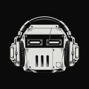

<h2 align="center">Hi, I'm m1t5</h2>

Founder of <b>Karps</b>. I build apps, games and open source tools, from music to Mario Kart to chess.

  
  
  
  

### Open source projects

| | Project | |
|---|---|---|
|  | **[MK Skin Studio](https://github.com/karps-games/mk-skin-studio)** Paint Mario Kart Wii characters in 3D and export them as a mod. | [Download](https://github.com/karps-games/mk-skin-studio/releases/latest) |
|  | **MK Launcher** Play Mario Kart Wii online on PC in 4K. | Coming soon |
| | **Karps Engine** The Dolphin based engine that powers MK Launcher. | Coming soon |
| | **Chengess** Change the pieces and the board on chess.com and lichess.org. | Coming soon |

### Products

| | Product | |
|---|---|---|
|  | **[KarpsMusic](https://karpsmusic.com)** Audio effects studio in the browser. | [Open](https://karpsmusic.com) |

### Stack

  
  
  
  
  
  
  
  
  

